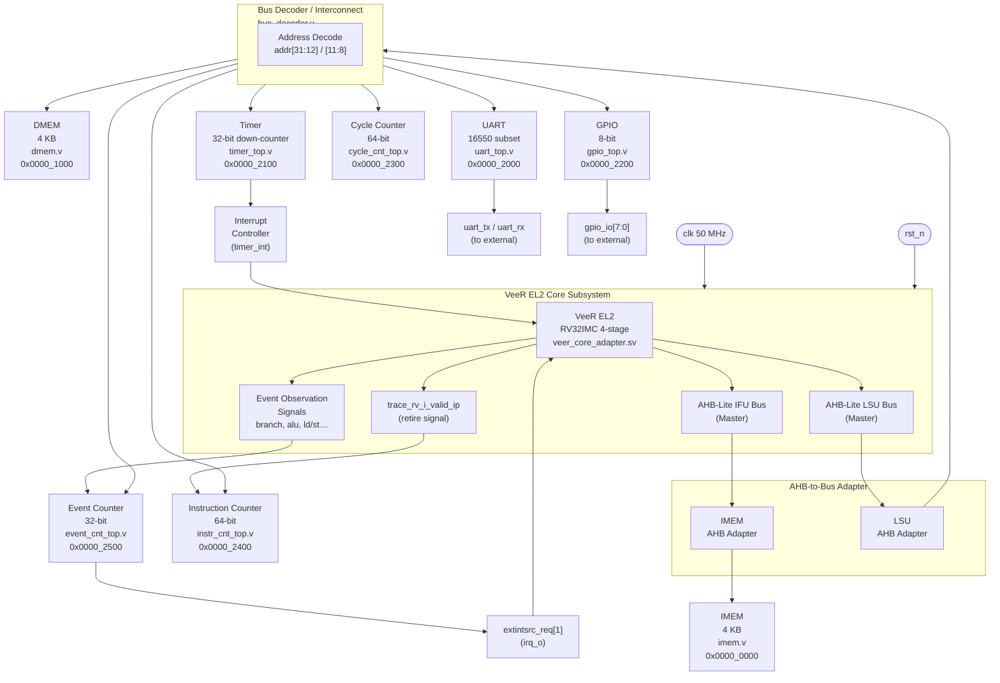
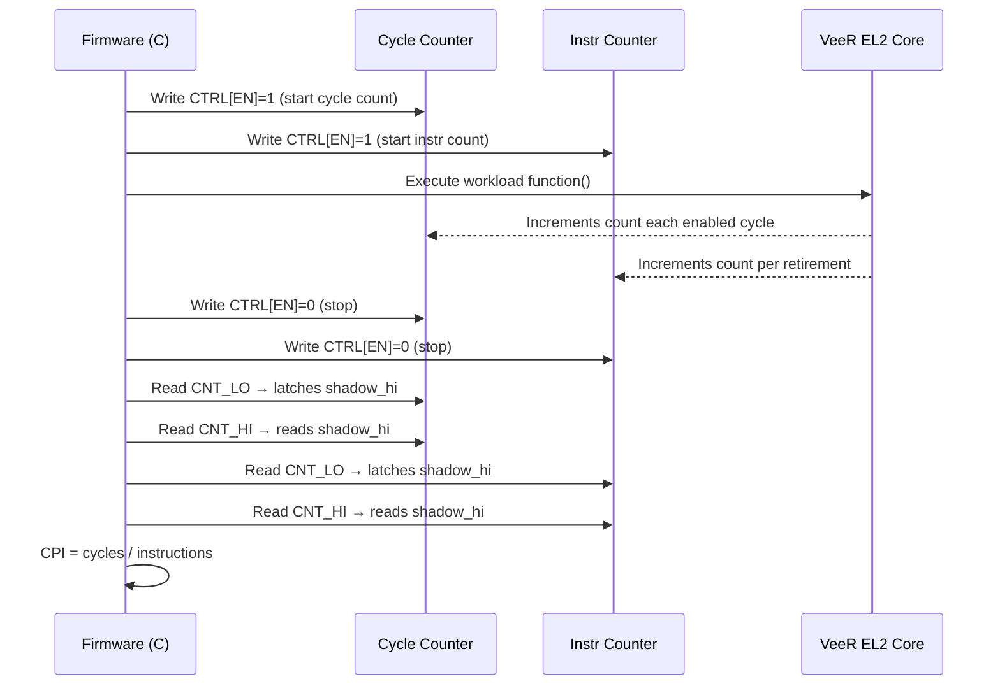
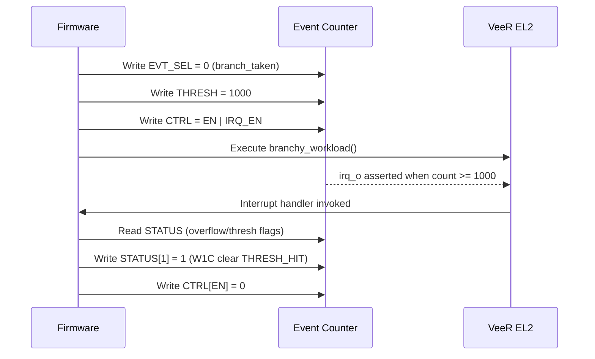

# Architecture Specification

## RISC-V Based SoC for Hardware Performance Monitoring and Event Analysis

---

| Field | Details |
|---|---|
| **Document Type** | Architecture Specification |
| **Project Title** | RISC-V Based SoC for Hardware Performance Monitoring and Event Analysis |
| **Student ID** | 1602-23-735-108 |
| **Revision** | 1.0 |
| **Status** | Final |

---

## 1. Overview

This document specifies the architecture of a complete, synthesizable RISC-V System-on-Chip (SoC) built for the purpose of hardware performance monitoring and event analysis. The SoC is centred on the **CHIPS Alliance VeeR EL2** processor core (RV32IMC, 4-stage in-order pipeline) and augments it with three custom **Hardware Performance Monitoring (HPM) IP blocks**, along with a standard peripheral set.

The fundamental design philosophy is:

- **Deterministic counting** – All counters are clocked synchronously and increment exactly once per qualifying event with no software overhead.
- **Coherent 64-bit reads** – A shadow-register protocol ensures that the high and low halves of 64-bit counters are always read from the same counter snapshot, preventing carry-induced errors.
- **Memory-mapped registers** – All HPM IPs and peripherals are accessed via a unified flat 32-bit physical address space using a simple, low-latency bus interconnect.
- **Synthesizability** – All RTL is Verilog-2001, free of latches, and uses only synchronous logic with an asynchronous active-low reset.

### 1.1 Key Specifications

| Parameter | Value |
|---|---|
| Processor | CHIPS Alliance VeeR EL2 |
| ISA | RV32IMC |
| Pipeline Stages | 4 (fetch, decode, execute, commit) |
| Clock Frequency | 50 MHz |
| Reset | Active-low asynchronous (`rst_n`) |
| Reset Vector | `0x0000_0000` |
| Instruction Memory | 4 KB SRAM (`imem.v`) |
| Data Memory | 4 KB SRAM (`dmem.v`) |
| HPM IPs | Cycle Counter, Instruction Counter, Event Counter |
| Peripherals | UART (16550 subset), Timer (32-bit), GPIO (8-bit) |
| Bus Protocol | Simple 32-bit memory-mapped, 1-cycle ready |
| RTL Language | Verilog-2001 |
| Simulation | Synopsys VCS + Verdi (FSDB) |

---

## 2. SoC Block Diagram



---

## 3. VeeR EL2 Core Subsystem

### 3.1 Core Description

The **CHIPS Alliance VeeR EL2** is an open-source, production-quality RISC-V processor implementing the RV32IMC instruction set. Its key micro-architectural features relevant to this project are:

| Feature | Detail |
|---|---|
| Pipeline depth | 4 stages: Fetch → Decode → Execute → Commit |
| Issue width | In-order, single-issue |
| Branch predictor | Gshare (configurable) |
| Load/Store Unit | Separate AHB-Lite master |
| Instruction Fetch Unit | Separate AHB-Lite master |
| CSRs | Full M-mode CSR set including mcycle / minstret |
| External interrupts | `extintsrc_req[31:1]` input bus |
| Retirement signal | `trace_rv_i_valid_ip[3:0]` (one bit per pipeline slot) |

### 3.2 AHB-Lite Master Interfaces

The VeeR EL2 exposes two independent AHB-Lite master interfaces:

**IFU (Instruction Fetch Unit) Bus:**
- Used exclusively for instruction fetch.
- Connected directly to `imem.v` via the IMEM AHB adapter.
- 32-bit address, 32-bit data, standard AHB-Lite control signals (`HTRANS`, `HSIZE`, `HBURST`, `HWRITE`, `HREADY`, `HRESP`).

**LSU (Load/Store Unit) Bus:**
- Used for all data memory accesses (loads, stores) and memory-mapped I/O.
- Connected to `bus_decoder.v` via the LSU AHB adapter.
- Supports byte, halfword, and word accesses.

### 3.3 `veer_core_adapter.sv`

This SystemVerilog wrapper module:
1. Instantiates the VeeR EL2 core with correct parameter settings.
2. Bridges the VeeR AHB-Lite master signals to the project's internal simple-bus format.
3. Extracts performance-related signals from the VeeR port list and routes them to the HPM IPs.

### 3.4 Instruction Retirement Signal

```
trace_rv_i_valid_ip[3:0]
```

This 4-bit signal is asserted by the VeeR EL2 commit stage. Each set bit indicates that the corresponding pipeline slot retired an instruction during that clock cycle. The Instruction Counter IP monitors this signal:

```verilog
assign retire_count = trace_rv_i_valid_ip[0] + trace_rv_i_valid_ip[1] +
                      trace_rv_i_valid_ip[2] + trace_rv_i_valid_ip[3];
```

In the current single-issue VeeR EL2, at most one bit is set per cycle, but the design is forward-compatible with wider retirement.

### 3.5 Event Observation Signals

The following signals are extracted from VeeR EL2 internals (or derived) and routed to the Event Counter IP:

| Signal | Source | Meaning |
|---|---|---|
| `branch_taken` | Execute stage | Branch resolved as taken |
| `branch_any` | Execute stage | Any branch instruction |
| `alu_op` | Execute stage | ALU operation executing |
| `load_op` | LSU | Load instruction issued |
| `store_op` | LSU | Store instruction issued |
| `stall_cycle` | Pipeline | Pipeline stall cycle |
| `ifu_miss` | IFU | Instruction fetch miss / wait |
| `retire_valid` | Commit | Instruction retired (alias) |

---

## 4. Bus Interconnect Architecture

### 4.1 `bus_decoder.v` Overview

The bus decoder is a simple, non-pipelined, single-master interconnect. It accepts the LSU bus request from the VeeR EL2 and routes it to exactly one peripheral slave based on address decoding. Key properties:

- **Single master**: Only the VeeR EL2 LSU is a master; no DMA or other masters.
- **1-cycle ready**: All slaves respond with `ready` asserted on the cycle following address presentation (no wait states in the nominal path).
- **Error response**: Any access to an unmapped address returns a bus error response (HRESP = ERROR on AHB-Lite, or an error flag on the internal bus).
- **No arbitration required**: Single master eliminates the need for an arbiter.

### 4.2 Address Decoding

Decoding uses three fields of the 32-bit address:

```
addr[31:12]  → selects 4 KB page (IMEM=0x0, DMEM=0x1, Peripherals=0x2)
addr[11:8]   → selects peripheral within page 0x2 (UART=0x0, Timer=0x1, GPIO=0x2,
                                                    CycleCnt=0x3, InstrCnt=0x4, EvtCnt=0x5)
addr[7:0]    → register offset within peripheral (passed to reg_slave_if)
```

The decode logic in `bus_decoder.v`:

```verilog
// Page select
always @(*) begin
    case (addr[31:12])
        20'h00000: sel_imem  = 1'b1;   // 0x00000xxx
        20'h00001: sel_dmem  = 1'b1;   // 0x00001xxx
        20'h00002: begin                // 0x00002xxx – peripheral page
            case (addr[11:8])
                4'h0: sel_uart  = 1'b1;
                4'h1: sel_timer = 1'b1;
                4'h2: sel_gpio  = 1'b1;
                4'h3: sel_ccnt  = 1'b1;
                4'h4: sel_icnt  = 1'b1;
                4'h5: sel_ecnt  = 1'b1;
                default: sel_err = 1'b1;
            endcase
        end
        default: sel_err = 1'b1;
    endcase
end
```

### 4.3 Internal Bus Protocol

The internal bus (between bus_decoder and all slaves) uses a minimal handshake:

| Signal | Direction | Width | Description |
|---|---|---|---|
| `addr` | Master→Slave | 32 | Physical address |
| `wdata` | Master→Slave | 32 | Write data |
| `wen` | Master→Slave | 1 | Write enable |
| `ren` | Master→Slave | 1 | Read enable |
| `be` | Master→Slave | 4 | Byte enables |
| `rdata` | Slave→Master | 32 | Read data (from selected slave) |
| `ready` | Slave→Master | 1 | Transfer complete |
| `error` | Slave→Master | 1 | Bus error |

---

## 5. HPM IP Architecture

All three HPM IPs share a common structure:

```
  ┌─────────────────────────────────────────────┐
  │                HPM IP                        │
  │  ┌────────────┐    ┌────────────────────┐   │
  │  │reg_slave_if│◄──►│  Control Registers │   │
  │  │  (bus I/F) │    │  (CTRL, STATUS…)   │   │
  │  └────────────┘    └─────────┬──────────┘   │
  │                              │ enable/clear  │
  │                    ┌─────────▼──────────┐   │
  │                    │   Counter Logic     │◄──┼── event_in
  │                    │  (up-counter)       │   │
  │                    └─────────┬──────────┘   │
  │                              │ count value   │
  │                    ┌─────────▼──────────┐   │
  │                    │  Shadow Registers  │   │
  │                    │ (CNT_LO / CNT_HI)  │   │
  │                    └────────────────────┘   │
  └─────────────────────────────────────────────┘
```

### 5.1 Cycle Counter (`cycle_cnt_top.v`)

**Purpose:** Count the number of clock cycles during which the counter is enabled.

**Register Map Summary:**

| Offset | Register | Access | Reset |
|---|---|---|---|
| 0x00 | CTRL | R/W | 0x0000_0000 |
| 0x04 | STATUS | R | 0x0000_0000 |
| 0x08 | CNT_LO | R | 0x0000_0000 |
| 0x0C | CNT_HI | R | 0x0000_0000 |

**Counting Mechanism:**

```verilog
always @(posedge clk or negedge rst_n) begin
    if (!rst_n)
        {cnt_hi_int, cnt_lo_int} <= 64'h0;
    else if (ctrl_clear)
        {cnt_hi_int, cnt_lo_int} <= 64'h0;
    else if (ctrl_enable)
        {cnt_hi_int, cnt_lo_int} <= {cnt_hi_int, cnt_lo_int} + 64'h1;
end
```

**Shadow Register Protocol:**

When software reads CNT_LO, the hardware atomically captures CNT_HI into a shadow register (`shadow_hi`). The subsequent read of CNT_HI returns `shadow_hi`, not the live counter, ensuring coherency:

```verilog
always @(posedge clk or negedge rst_n) begin
    if (!rst_n)
        shadow_hi <= 32'h0;
    else if (rd_cnt_lo)   // CNT_LO read strobe
        shadow_hi <= cnt_hi_int;
end

assign cnt_hi_rd = shadow_hi;
assign cnt_lo_rd = cnt_lo_int;
```

**CTRL Register Bit Fields:**

| Bit | Name | Description |
|---|---|---|
| [0] | `EN` | Counter enable (1 = count, 0 = freeze) |
| [1] | `CLR` | Self-clearing counter clear |
| [31:2] | — | Reserved |

### 5.2 Instruction Counter (`instr_cnt_top.v`)

**Purpose:** Count retired instructions using the VeeR EL2 `trace_rv_i_valid_ip` signal.

**Key Difference from Cycle Counter:**

Instead of incrementing by 1 per cycle, the instruction counter increments by the number of valid retirement slots:

```verilog
wire [2:0] retire_inc = trace_rv_i_valid_ip[0] + trace_rv_i_valid_ip[1] +
                        trace_rv_i_valid_ip[2] + trace_rv_i_valid_ip[3];

always @(posedge clk or negedge rst_n) begin
    if (!rst_n)
        {cnt_hi_int, cnt_lo_int} <= 64'h0;
    else if (ctrl_clear)
        {cnt_hi_int, cnt_lo_int} <= 64'h0;
    else if (ctrl_enable && retire_valid)
        {cnt_hi_int, cnt_lo_int} <= {cnt_hi_int, cnt_lo_int} + {61'h0, retire_inc};
end
```

The same shadow-register protocol as the Cycle Counter is used for coherent 64-bit reads.

**Register Map:** Identical structure to Cycle Counter (CTRL, STATUS, CNT_LO, CNT_HI at offsets 0x00–0x0C).

### 5.3 Performance Event Counter (`event_cnt_top.v`)

**Purpose:** Count any one of 8 selectable hardware events, with threshold comparison and interrupt generation.

**Register Map Summary:**

| Offset | Register | Access | Reset |
|---|---|---|---|
| 0x00 | CTRL | R/W | 0x0000_0000 |
| 0x04 | EVT_SEL | R/W | 0x0000_0000 |
| 0x08 | COUNT | R | 0x0000_0000 |
| 0x0C | THRESH | R/W | 0xFFFF_FFFF |
| 0x10 | STATUS | R/W1C | 0x0000_0000 |

**Event Selection:**

```verilog
always @(*) begin
    case (evt_sel_reg[2:0])
        3'd0: event_in = branch_taken;
        3'd1: event_in = branch_any;
        3'd2: event_in = alu_op;
        3'd3: event_in = load_op;
        3'd4: event_in = store_op;
        3'd5: event_in = stall_cycle;
        3'd6: event_in = ifu_miss;
        3'd7: event_in = retire_valid;
        default: event_in = 1'b0;
    endcase
end
```

**Threshold and Interrupt Logic:**

```verilog
// Threshold compare
wire thresh_hit = (count_int >= thresh_reg);

// Sticky overflow
always @(posedge clk or negedge rst_n) begin
    if (!rst_n)
        status_overflow <= 1'b0;
    else if (status_w1c_clear)   // software W1C
        status_overflow <= 1'b0;
    else if (&count_int)         // all-ones = overflow
        status_overflow <= 1'b1;
end

// Interrupt output
assign irq_o = ctrl_irq_en & (thresh_hit | status_overflow);
```

**CTRL Register Bit Fields:**

| Bit | Name | Description |
|---|---|---|
| [0] | `EN` | Counter enable |
| [1] | `CLR` | Self-clearing counter clear |
| [2] | `IRQ_EN` | Interrupt enable mask |
| [31:3] | — | Reserved |

**EVT_SEL Register:**

| Bit | Name | Description |
|---|---|---|
| [2:0] | `SEL` | Event select (0–7) |
| [31:3] | — | Reserved |

**STATUS Register (W1C):**

| Bit | Name | Description |
|---|---|---|
| [0] | `OVERFLOW` | Sticky overflow flag; write 1 to clear |
| [1] | `THRESH_HIT` | Threshold compare flag; write 1 to clear |
| [31:2] | — | Reserved |

---

## 6. Peripheral Subsystem

### 6.1 UART (`uart_top.v`)

A minimal UART implementing a subset of the 16550 register set:

| Feature | Implementation |
|---|---|
| Data format | 8N1 (8 data bits, no parity, 1 stop bit) |
| Baud rate | Programmed via 16-bit divisor register |
| TX FIFO | 16-byte transmit FIFO |
| RX FIFO | 16-byte receive FIFO |
| Interrupts | TX empty, RX data available |

**Baud rate formula:**

$$\text{Baud} = \frac{f_{clk}}{16 \times \text{DIVISOR}}$$

At 50 MHz, for 115200 baud: DIVISOR = 27 (actual baud = 115,741).

**Key Registers:**

| Offset | Register | Description |
|---|---|---|
| 0x00 | RBR (read) / THR (write) | Receive Buffer / Transmit Hold |
| 0x04 | IER | Interrupt Enable |
| 0x08 | DIVISOR | Baud rate divisor (16-bit) |
| 0x0C | LCR | Line Control |
| 0x10 | LSR | Line Status |

### 6.2 Timer (`timer_top.v`)

A simple 32-bit down-counting timer:

| Feature | Implementation |
|---|---|
| Counter width | 32-bit |
| Mode | Down-count from RELOAD to 0 |
| Auto-reload | Configurable via CTRL[1] |
| Interrupt | Single-cycle pulse `timer_int` when counter hits 0 |

**Counting behaviour:**

```verilog
always @(posedge clk or negedge rst_n) begin
    if (!rst_n)
        count <= 32'h0;
    else if (!ctrl_en)
        count <= reload_reg;
    else if (count == 32'h0) begin
        timer_int <= 1'b1;
        count <= ctrl_autoreload ? reload_reg : 32'h0;
    end else begin
        timer_int <= 1'b0;
        count <= count - 32'h1;
    end
end
```

### 6.3 GPIO (`gpio_top.v`)

An 8-bit bidirectional GPIO controller:

| Feature | Implementation |
|---|---|
| Width | 8 bits |
| Direction control | Per-bit via DIR register (1=output, 0=input) |
| Output data | OUT register |
| Input data | IN register (reads pin state) |

```verilog
genvar i;
generate
    for (i = 0; i < 8; i = i + 1) begin : gpio_pins
        assign gpio_io[i] = dir_reg[i] ? out_reg[i] : 1'bz;
        assign in_reg[i]  = gpio_io[i];
    end
endgenerate
```

---

## 7. Register Interface Architecture (`reg_slave_if.v`)

All peripherals and HPM IPs use a shared parameterised register slave interface module. This module:

1. **Receives** the internal bus signals (`addr`, `wdata`, `wen`, `ren`, `be`).
2. **Generates** individual register write-enable strobes (`reg0_we`, `reg1_we`, …).
3. **Multiplexes** individual register read-data onto a shared `rdata` output.
4. **Asserts** `ready` one cycle after a valid request.

```verilog
module reg_slave_if #(
    parameter NUM_REGS   = 4,
    parameter ADDR_BITS  = 8
) (
    input  wire                        clk,
    input  wire                        rst_n,
    // Bus interface
    input  wire [31:0]                 addr,
    input  wire [31:0]                 wdata,
    input  wire                        wen,
    input  wire                        ren,
    input  wire [3:0]                  be,
    output reg  [31:0]                 rdata,
    output reg                         ready,
    // Register strobes
    output wire [NUM_REGS-1:0]         reg_we,
    output wire [$clog2(NUM_REGS)-1:0] reg_sel,
    output wire [31:0]                 reg_wdata,
    // Register read data from IP
    input  wire [32*NUM_REGS-1:0]      reg_rdata_flat
);
```

The `reg_we` output is a one-hot vector; each IP decodes its own register offset from `reg_sel`.

---

## 8. Clock and Reset Architecture

### 8.1 Clock

| Parameter | Value |
|---|---|
| Clock source | Single global `clk` input |
| Frequency | 50 MHz (20 ns period) |
| Clock domains | 1 (single-clock design) |
| Clock gating | None (intentionally avoided for synthesizability) |

All flip-flops in the design are sensitive to `posedge clk`. There are no internally-generated clocks, no PLLs, and no clock muxes, making the design straightforward to synthesize and time.

### 8.2 Reset

| Parameter | Value |
|---|---|
| Reset signal | `rst_n` (active-low) |
| Reset style | Asynchronous assertion, synchronous de-assertion |
| Reset vector | `0x0000_0000` (start of IMEM) |

```verilog
// Standard reset template used throughout the design
always @(posedge clk or negedge rst_n) begin
    if (!rst_n)
        q <= RESET_VALUE;
    else
        q <= d;
end
```

The VeeR EL2 core's internal reset is connected to `rst_n`. All HPM IPs and peripherals share the same `rst_n`.

---

## 9. Interrupt Architecture

```
VeeR EL2 Interrupt Inputs:
  timer_int          ─────────────────► extintsrc_req[0]  (or timer_int direct)
  event_cnt irq_o    ─────────────────► extintsrc_req[1]
  soft_int           ─────────────────► soft_int
```

| Interrupt Signal | Source | Priority | Clearance |
|---|---|---|---|
| `timer_int` | Timer peripheral (count → 0) | — | Auto-clear (single cycle pulse) |
| `extintsrc_req[1]` | Event Counter `irq_o` | — | W1C STATUS register in Event Counter |
| `soft_int` | Software (memory-mapped) | — | Software-cleared |

The VeeR EL2 handles interrupt prioritisation according to the RISC-V M-mode privilege specification. External interrupts are routed through the `extintsrc_req` vector. The interrupt handler must:

1. Read `EVENT_COUNTER_STATUS` to determine cause (overflow or threshold).
2. Write 1 to the appropriate STATUS bit to clear the interrupt (W1C).
3. Optionally update `THRESH` before returning.

---

## 10. Performance Event Mapping Table

| EVT_SEL | Event Name | Signal | Description | Firmware Stimulus |
|---|---|---|---|---|
| 0 | `BRANCH_TAKEN` | `branch_taken` | Conditional branch resolved taken | Execute loop with taken branch |
| 1 | `BRANCH_ANY` | `branch_any` | Any branch instruction (taken or not) | Mix of branch instructions |
| 2 | `ALU_OP` | `alu_op` | ALU operation executing | Integer arithmetic sequence |
| 3 | `LOAD_OP` | `load_op` | Load instruction to LSU | Array traversal (read) |
| 4 | `STORE_OP` | `store_op` | Store instruction to LSU | Array traversal (write) |
| 5 | `STALL_CYCLE` | `stall_cycle` | Pipeline stall cycle | RAW hazard sequence |
| 6 | `IFU_MISS` | `ifu_miss` | IFU fetch wait / cache miss | Non-sequential instruction flow |
| 7 | `RETIRE_VALID` | `retire_valid` | Instruction committed | Any executing code (alias for instr counter) |

---

## 11. Data Flow Diagrams

### 11.1 CPI Measurement Flow

The standard software sequence for measuring Cycles Per Instruction (CPI) using the HPM subsystem:



### 11.2 Event Interrupt Flow



### 11.3 Shadow Register Read Protocol

```
Time →      T0          T1          T2          T3
           READ        READ
         CNT_LO      CNT_HI       (compute)
            │           │
            ▼           ▼
Counter:  ...N...    ...N+2...   (live counter keeps running)
Shadow:    captures N+? at T0 → shadow_hi holds the right half
Returned:   lo[T0]   shadow_hi[captured at T0]
            └───────────┘
            Coherent 64-bit pair
```

**Rule:** Always read CNT_LO before CNT_HI. The act of reading CNT_LO atomically snapshots the current CNT_HI into the shadow register.

---

## 12. Design Constraints

| Constraint | Requirement |
|---|---|
| RTL language | Verilog-2001 strictly (no SystemVerilog constructs in synthesizable RTL) |
| Latch-free | All state must be in `always @(posedge clk)` or `always @(posedge clk or negedge rst_n)` blocks |
| No magic numbers | All constants in `localparam` or header files; no raw numeric literals in logic |
| No tristate inside SoC | Tristate (`1'bz`) only on GPIO pad outputs; all internal buses are muxed |
| Reset completeness | Every flip-flop must have a defined reset value |
| Synthesis clean | No `initial` blocks in synthesizable modules; `initial` only in testbenches |
| Byte enable support | All memory and peripheral writes must respect `be[3:0]` byte enables |
| No clock gating cells | Clock gating only via enable logic on D-inputs, not on the clock net |

---

*End of Architecture Specification*
