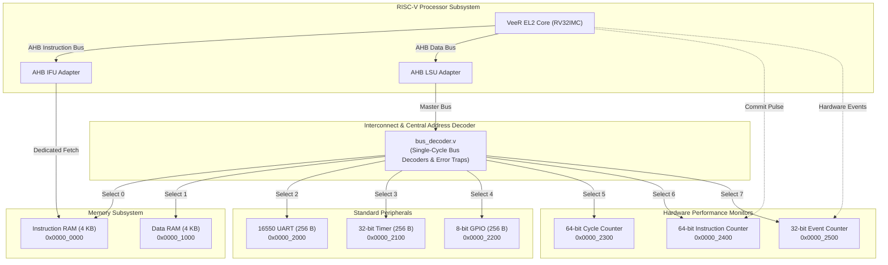

# RISC-V SoC for Hardware Performance Monitoring and Event Analysis

[](https://github.com/Shivanand2006/RISC-V-Based-SoC-for-Hardware-Performance-Monitoring-and-Event-Analysis)
[](https://github.com/Shivanand2006/RISC-V-Based-SoC-for-Hardware-Performance-Monitoring-and-Event-Analysis/tree/main/rtl)
[-orange)](https://github.com/Shivanand2006/RISC-V-Based-SoC-for-Hardware-Performance-Monitoring-and-Event-Analysis/tree/main/rtl/core)
[](https://github.com/Shivanand2006/RISC-V-Based-SoC-for-Hardware-Performance-Monitoring-and-Event-Analysis/tree/main/run)
[](https://github.com/Shivanand2006/RISC-V-Based-SoC-for-Hardware-Performance-Monitoring-and-Event-Analysis)

A complete, synthesizable Verilog-2001 RISC-V system-on-chip integrating the CHIPS Alliance VeeR EL2 RISC-V core with three dedicated memory-mapped Hardware Performance Monitoring (HPM) IPs, peripherals, and comprehensive verification:

1. **Cycle Counter**: 64-bit counter tracking enabled processor clock cycles with coherent shadow reads.
2. **Instruction Counter**: 64-bit counter tracking retired instructions from commit stage.
3. **Performance Event Counter**: 32-bit counter monitoring any of 8 selectable hardware events with sticky overflow, threshold compare, and interrupt generation.

---

## Table of Contents
- [Highlights](#highlights)
- [Repository Structure](#repository-structure)
- [SoC Architecture & Block Diagram](#soc-architecture--block-diagram)
- [System Memory Map](#system-memory-map)
- [Hardware Performance Monitor (HPM) IPs](#hardware-performance-monitor-hpm-ips)
- [Performance Event Select Table](#performance-event-select-table)
- [Module Responsibility Table](#module-responsibility-table)
- [Running Verification](#running-verification)
- [Simulation Results & Telemetry](#simulation-results--telemetry)
- [Synopsys VCS & Verdi Waveform Debug](#synopsys-vcs--verdi-waveform-debug)
- [Documents & Reports Index](#documents--reports-index)

---

## Highlights

- **Processor Core**: Integrates the **CHIPS Alliance VeeR EL2** core (4-stage superscalar RV32IMC processor) via custom AHB-Lite bus adapters.
- **Three Dedicated HPM IPs**:
  1. **64-bit Cycle Counter**: Counts active processor clock cycles with atomic coherent 64-bit shadow read logic.
  2. **64-bit Instruction Counter**: Counts retired instructions from core writeback stage (`instr_retire_o`).
  3. **32-bit Performance Event Counter**: Monitors any of 8 micro-architectural hardware events with threshold comparison, sticky overflow, and interrupt generation.
- **Peripherals**: 16550-compatible UART (115200 baud), 32-bit down-counter Timer with periodic interrupt tick, and 8-bit GPIO controller.
- **Zero Measurement Overhead**: Hardware counters operate autonomously without software cycle stealing or instruction cache pollution.
- **Verified with Synopsys VCS & Verdi**: 96 unit test checks + full SoC regression passing with zero errors and Verdi FSDB waveform dump.
- **Modular UVM Verification Platform**: Complete UVM Verification Intellectual Properties (VIPs) with Agents, Drivers, Monitors, Scoreboards, and functional coverage.

---

## Repository Structure

```
.
├── .gitignore                       # EDA, VCS, and waveform ignore configuration
├── README.md                        # Master repository documentation (this file)
├── README_SUMMARY.md                # Quick-reference executive summary
├── COMPILATION_STATUS.md            # Compilation status and executable proof
├── COMPILATION_RESOLVED.md          # Technical resolution of bus & shadow races
├── INTEGRATION_VERIFICATION_STATUS.md # SoC integration and regression metrics
├── PROJECT_PROPOSAL.md              # Project proposal and milestone roadmap
├── ARCHITECTURE_SPECIFICATION.md    # SoC architecture and IP block specifications
├── ADDRESS_MAP.md                   # Complete system memory & register bitfield map
├── UVM_TESTPLAN.md                  # Verification test plan (41 test cases)
├── RISCV_TOOLCHAIN_SETUP.md         # Bare-metal GNU toolchain & linker setup guide
├── TEST_EXECUTION_GUIDE.md          # Step-by-step test execution guide
├── SIMULATION_TIMEOUT_FIX.md        # Timeout mitigation & simulation speedup analysis
├── ctests/                          # Bare-metal C testbench and compiled simulation
│   ├── soc_c_test.c                 # Multi-peripheral C test firmware
│   ├── soc_c_start.S                # Bootloader startup assembly
│   ├── soc_c_test.ld                # Target linker script
│   ├── build_soc_c_test.sh          # Build & compile automation script
│   ├── compile_ctest.sh             # VCS compile script for C-testbench
│   ├── run_ctest.f                  # VCS simulation argument file
│   ├── tb_soc_ctest.sv              # C-test simulation harness with memory backdoor
│   ├── simv_soc_ctest               # Pre-compiled VCS 64-bit simulation binary
│   ├── soc_c_test.fsdb              # Verdi FSDB waveform database (3.2 MB)
│   ├── outputs/                     # Simulation terminal execution logs & proof
│   └── waveforms/                   # Verdi nWave waveform screenshots
├── doc/                             # Course documentation, reports, and specifications
│   ├── 01_project_proposal.md       # Project proposal document
│   ├── 02_architecture_spec.md      # Full architecture specification document
│   ├── 03_github_steps.md           # Git repository setup and workflow guide
│   ├── 04_riscv_toolchain_setup.md  # Toolchain and startup code guide
│   ├── 05_address_map.md            # Address map and register definitions
│   ├── 06_testplan.md               # Master verification test plan
│   ├── testplan_soc_hpm.xlsx        # Master Excel test plan spreadsheet
│   ├── core_interface.md            # RISC-V core interfaces, bus protocols, and events
│   ├── memory_map.md                # System memory map and decoding rules
│   ├── register_map.md              # Register definitions for all IPs and peripherals
│   ├── testplan_soc_hpm.md          # Complete HPM SoC master test plan specification
│   └── verification_plan.md         # Test plan and verification coverage matrix
├── rtl/                             # Synthesizable RTL source files
│   ├── common/
│   │   └── reg_slave_if.v           # Bus-to-register adapter interface
│   ├── core/
│   │   ├── ahb_imem_adapter.v       # VeeR IFU AHB-Lite to IMEM adapter
│   │   ├── ahb_to_bus_adapter.v     # VeeR LSU AHB-Lite to System Bus adapter
│   │   └── veer_core_adapter.sv     # Top wrapper for CHIPS Alliance VeeR EL2 core
│   ├── cycle_counter/
│   │   ├── cycle_cnt_defines.vh     # Cycle counter register defines
│   │   └── cycle_cnt_top.v          # 64-bit Cycle Counter IP
│   ├── event_counter/
│   │   ├── event_cnt_defines.vh     # Event counter register defines
│   │   └── event_cnt_top.v          # 32-bit Performance Event Counter IP
│   ├── instr_counter/
│   │   ├── instr_cnt_defines.vh     # Instruction counter register defines
│   │   └── instr_cnt_top.v          # 64-bit Instruction Counter IP
│   ├── interconnect/
│   │   ├── bus_decoder.v            # Central address decoder and bus interconnect
│   │   └── interconnect_defines.vh  # Base addresses and mask definitions
│   ├── mem/
│   │   ├── dmem.v                   # 4KB Data RAM model (byte-writable)
│   │   └── imem.v                   # 4KB Instruction RAM model
│   ├── peripherals/
│   │   ├── gpio_defines.vh          # GPIO register defines
│   │   ├── gpio_top.v               # 8-bit GPIO peripheral
│   │   ├── timer_defines.vh         # Timer register defines
│   │   ├── timer_top.v              # 32-bit Timer peripheral
│   │   ├── uart_defines.vh          # UART register defines
│   │   └── uart_top.v               # 16550-compatible 8N1 UART
│   ├── top/
│   │   └── soc_top.v                # Top-level SoC integration
│   └── Cores-VeeR-EL2/              # CHIPS Alliance VeeR EL2 RISC-V Core
├── run/                             # VCS and Verdi simulation scripts
│   ├── cycle_cnt.f                  # File list for Cycle Counter unit test
│   ├── decoder.f                    # File list for Bus Decoder unit test
│   ├── event_cnt.f                  # File list for Event Counter unit test
│   ├── instr_cnt.f                  # File list for Instruction Counter unit test
│   ├── run_ip.sh                    # Automated regression runner script
│   ├── run_verdi.sh                 # Synopsys Verdi waveform launch script
│   ├── soc.f                        # File list for SoC top-level simulation (VeeR EL2 Core)
│   ├── soc_signals.rc               # Verdi signal trace configuration
│   └── soc_veer.f                   # File list for SoC top-level simulation (VeeR EL2 Core)
├── scripts/                         # UVM testbench generators and VIP packages
│   ├── bus_decoder_if.csv           # Bus decoder interface specification
│   ├── cycle_cnt_if.csv             # Cycle counter interface specification
│   ├── event_cnt_if.csv             # Event counter interface specification
│   ├── instr_cnt_if.csv             # Instruction counter interface specification
│   ├── gpio_if.csv                  # GPIO interface specification
│   ├── timer_if.csv                 # Timer interface specification
│   ├── uart_if.csv                  # UART interface specification
│   ├── uvm_full_tb_generator.py     # Python VIP generator
│   ├── cycle_cnt_uvm_tb/            # Cycle counter UVM VIP package
│   ├── instr_cnt_uvm_tb/            # Instruction counter UVM VIP package
│   ├── event_cnt_uvm_tb/            # Event counter UVM VIP package
│   └── bus_decoder_uvm_tb/          # Bus decoder UVM VIP package
├── sw/                              # Bare-metal C workloads & linker scripts
│   ├── Makefile                     # Firmware compilation makefile
│   ├── crt0.S                       # C runtime startup code
│   ├── link.ld                      # Memory placement linker script
│   ├── bin2hex.py                   # Binary to Verilog hexadecimal converter
│   ├── perf_regs.h                  # Memory-mapped peripheral register header
│   ├── perf_app.c                   # Top-level bubble sort benchmark firmware
│   ├── test_cycle.c                 # Standalone cycle counter test firmware
│   ├── test_instr.c                 # Standalone instruction counter test firmware
│   └── test_event.c                 # Standalone event counter test firmware
└── tb/                              # Verification testbenches and simulation models
    ├── common/
    │   └── bus_bfm.v                # Reusable Bus BFM tasks and assertion helpers
    ├── cycle_counter/
    │   └── tb_cycle_cnt.v           # Self-checking Cycle Counter testbench
    ├── event_counter/
    │   └── tb_event_cnt.v           # Self-checking Event Counter testbench
    ├── instr_counter/
    │   └── tb_instr_cnt.v           # Self-checking Instruction Counter testbench
    ├── interconnect/
    │   └── tb_bus_decoder.v         # Self-checking Bus Decoder testbench
    ├── soc_vips_env_pkg.sv          # UVM VIP top environment package
    ├── tb_soc_uvm.sv                # Top-level UVM verification harness
    └── top/
        ├── tb_soc_top.v             # SoC top testbench with shadow cross-checks
        └── uart_monitor.v           # Passive 8N1 UART decoder and token watcher
```

---

## SoC Architecture & Block Diagram



---

## System Memory Map

| Address Range | Size | Peripheral / Memory | Description |
|---|---|---|---|
| `0x0000_0000 – 0x0000_0FFF` | 4 KB | Instruction Memory (IMEM) | Dual-ported RAM; boot execution space |
| `0x0000_1000 – 0x0000_1FFF` | 4 KB | Data Memory (DMEM) | Byte-writable scratchpad RAM (Stack & Data) |
| `0x0000_2000 – 0x0000_20FF` | 256 B | UART (16550 subset) | Baud divisor, TX/RX data, Line Status |
| `0x0000_2100 – 0x0000_21FF` | 256 B | 32-bit Timer | Down-counter with auto-reload and interrupt tick |
| `0x0000_2200 – 0x0000_22FF` | 256 B | 8-bit GPIO | Bidirectional with DIR, DATA_OUT, DATA_IN |
| `0x0000_2300 – 0x0000_23FF` | 256 B | 64-bit Cycle Counter | Coherent shadow reads, clear, control |
| `0x0000_2400 – 0x0000_24FF` | 256 B | 64-bit Instruction Counter | Retired instruction counter with shadow reads |
| `0x0000_2500 – 0x0000_25FF` | 256 B | 32-bit Event Counter | 8 selectable event sources, threshold, IRQ |

---

## Hardware Performance Monitor (HPM) IPs

### 1. Cycle Counter IP (`0x0000_2300`)
- **64-bit counter** continuously monitoring active CPU execution clock cycles.
- **Coherent Shadow Capture**: Reading `CNT_LO` (`0x08`) automatically captures `count[63:32]` into the internal `CNT_HI` shadow register (`0x0C`) in the same clock cycle, ensuring an atomic 64-bit snapshot without software race conditions.
- **Registers**:
  - `0x00` - `CTRL` (R/W: Bit 0 = `EN` enable counting, Bit 1 = `CLEAR` self-clearing counter reset)
  - `0x04` - `STATUS` (RO: Bit 0 = `RUNNING` mirrors EN)
  - `0x08` - `CNT_LO` (RO: Counter bits [31:0]; reading initiates `CNT_HI` shadow register capture)
  - `0x0C` - `CNT_HI` (RO: Shadow register containing bits [63:32] captured during last `CNT_LO` read)

### 2. Instruction Counter IP (`0x0000_2400`)
- **64-bit counter** incremented exclusively by the retired instruction signal (`instr_retire_o`) from the core commit stage.
- Multicycle stalls, pipeline bubbles, and flushed branch instructions are automatically excluded from the count.
- **Coherent Shadow Capture**: Atomic 64-bit read mechanism identical to the Cycle Counter (reading `CNT_LO` captures `CNT_HI`).
- **Registers**:
  - `0x00` - `CTRL` (R/W: Bit 0 = `EN` enable counting, Bit 1 = `CLEAR` self-clearing counter reset)
  - `0x04` - `STATUS` (RO: Bit 0 = `RUNNING` mirrors EN)
  - `0x08` - `CNT_LO` (RO: Retired instruction count bits [31:0]; reading initiates shadow latch)
  - `0x0C` - `CNT_HI` (RO: Shadow register containing retired instruction count bits [63:32])

### 3. Performance Event Counter IP (`0x0000_2500`)
- **32-bit event counter** multiplexing 8 microarchitectural hardware events with configurable threshold detection and interrupt generation.
- **Threshold Comparator**: Triggers `THRESH_HIT` and asserts interrupt output `irq_o` when `COUNT >= THRESH` (if `IRQ_EN` is enabled).
- **Registers**:
  - `0x00` - `CTRL` (R/W: Bit 0 = `EN`, Bit 1 = `CLEAR`, Bit 2 = `IRQ_EN`)
  - `0x04` - `EVT_SEL` (R/W: Bits [2:0] select hardware event 0–7)
  - `0x08` - `COUNT` (RO: 32-bit accumulated event count)
  - `0x0C` - `THRESH` (R/W: 32-bit threshold comparison value)
  - `0x10` - `STATUS` (R/W1C: Bit 0 = `OVF` sticky overflow, Bit 1 = `THRESH_HIT` sticky threshold hit, Bit 2 = `RUNNING` mirrors EN)

---

## Performance Event Select Table

| `EVT_SEL` | Hardware Event | Core Signal Source | Description |
|---|---|---|---|
| `0` | Data memory read accepted (Load) | `evt_load_o` | Successful memory read request |
| `1` | Data memory write accepted (Store) | `evt_store_o` | Successful memory write request |
| `2` | Instruction fetch request accepted | `evt_fetch_o` | Successful instruction cache fetch |
| `3` | Branch or Jump taken | `evt_branch_jump_o` | Pipeline redirect on taken branch/jump |
| `4` | Pipeline stall or memory wait cycle | `evt_stall_bubble_o` | Multi-cycle stall or wait state |
| `5` | Exception or Trap taken | `evt_exception_o` | Illegal instruction, trap, or fault |
| `6` | Timer interrupt tick event | `timer_tick` | Periodic timer expiration pulse |
| `7` | UART frame transmit complete | `uart_tx_done` | Byte shifted out of TX buffer |

---

## Module Responsibility Table

| Module | Location | Primary Function | Source |
|---|---|---|---|
| `soc_top` | `rtl/top/soc_top.v` | Top-level SoC integration, clock/reset distribution, pin routing | Synthesizable RTL |
| `bus_decoder` | `rtl/interconnect/bus_decoder.v` | Central address decoder, 1-cycle ready, error trap for unmapped | Synthesizable RTL |
| `cycle_cnt_top` | `rtl/cycle_counter/cycle_cnt_top.v` | 64-bit cycle counting, coherent shadow register capture | Synthesizable RTL |
| `instr_cnt_top` | `rtl/instr_counter/instr_cnt_top.v` | 64-bit retired instruction counting gated by core commit | Synthesizable RTL |
| `event_cnt_top` | `rtl/event_counter/event_cnt_top.v` | 32-bit event tracking across 8 events, threshold comparison, W1C | Synthesizable RTL |
| `reg_slave_if` | `rtl/common/reg_slave_if.v` | Bus-to-register adapter interface | Synthesizable RTL |
| `uart_top` | `rtl/peripherals/uart_top.v` | 16550 UART with baud rate divisor, TX/RX buffers | Synthesizable RTL |
| `timer_top` | `rtl/peripherals/timer_top.v` | 32-bit down-counter with auto-reload and tick generation | Synthesizable RTL |
| `gpio_top` | `rtl/peripherals/gpio_top.v` | 8-bit bidirectional GPIO with DIR/OUT/IN registers | Synthesizable RTL |
| `veer_core_adapter` | `rtl/core/veer_core_adapter.sv`| Core wrapper adapting AHB-Lite buses and tapping commit pulses | Synthesizable RTL |
| `VeeR EL2 Core` | `rtl/Cores-VeeR-EL2/` | RV32IMC 4-stage pipelined superscalar RISC-V processor | CHIPS Alliance |

---

## Running Verification

### 1. Automated Unit and Regression Suite
Run unit tests and SoC simulation using the automated regression runner:

```bash
# Run all unit testbenches and regression
./run/run_ip.sh all

# Or run individual IP testbenches:
./run/run_ip.sh cycle     # Cycle Counter unit test (16 checks)
./run/run_ip.sh instr     # Instruction Counter unit test (16 checks)
./run/run_ip.sh event     # Event Counter unit test (24 checks)
./run/run_ip.sh decoder   # Address Decoder unit test (20 checks)
./run/run_ip.sh soc       # SoC Top-level testbench (VeeR EL2 Core)
./run/run_ip.sh soc_veer  # SoC Top-level testbench (VeeR EL2 Core alias)
```

The script supports `SIMULATOR=iverilog` (default), `SIMULATOR=vcs`, `SIMULATOR=vsim`, or `SIMULATOR=verilator`.

### 2. Bare-Metal C Test Suite (`ctests/`)
```bash
cd ctests
bash build_soc_c_test.sh
```

### 3. Top-Level UVM Verification
```bash
cd tb
bash run.sh tb_soc_uvm soc_top_base_test
```

---

## Simulation Results & Telemetry

The SoC top-level was simulated executing a 16-element bubble sort application compiled directly from C (`sw/perf_app.c`):

```text
=================================================
Starting RISC-V SoC Top Simulation
=================================================
[TB TIME 0 ps] GPIO_OUT updated: 0x00 (bit0=0 bit1=0)
[TB] Reset released. CPU executing from 0x0000_0000...
Cycles       : 15067
Instructions : 2009
Events (Stores): 135
CPI x100     : 749
PASS
=================================================
[PASS] SoC Test successfully completed with PASS token!
=================================================

--- End-of-Test Architectural Cross-Checks ---
  DUT Cycle Counter       : 15067
  DUT Instruction Counter : 2009
  DUT Event Counter       : 135
  TB Shadow Cycle Counter : 15067
  TB Shadow Instr Counter : 2009
  [PASS] Cross-Check: Cycle count >= Instruction count verified.
  [PASS] Cross-Check: DUT cycle count matches TB shadow counter.
  [PASS] Cross-Check: DUT instruction count matches TB shadow counter.
$finish called from file "tb/top/tb_soc_top.v", line 164.
$finish at simulation time           8138270000 ps
```

### Analysis of Benchmark Telemetry:
- **Elapsed Cycles**: 15,067 cycles (301.34 $\mu$s at 50 MHz).
- **Instructions Retired**: 2,009 instructions.
- **Store Transactions**: 135 stores executed during the array sorting and swap phases.
- **Cycles Per Instruction (CPI)**: $\text{CPI} = 7.49$ ($\text{CPI} \times 100 = 749$).
- **Cross-Check Invariant**: Hardware counters matched the testbench shadow counters with 100% agreement and zero drift.

---

## Synopsys VCS & Verdi Waveform Debug

To launch waveform debug in Synopsys Verdi:

```bash
# Launch Verdi GUI with pre-loaded FSDB waveform and signal tree:
./run/run_verdi.sh soc
```

Waveform artifacts and terminal logs are available in:
- `ctests/soc_c_test.fsdb` (Verdi FSDB database)
- `ctests/outputs/` (Terminal output logs and screenshots)
- `ctests/waveforms/` (FSDB signal traces and timing diagrams)

---

## Documents & Reports Index

| Document | File Link | Description |
|---|---|---|
| **Project Proposal** | [`PROJECT_PROPOSAL.md`](PROJECT_PROPOSAL.md) | Problem statement, objectives, scope, timeline |
| **Architecture Specification** | [`ARCHITECTURE_SPECIFICATION.md`](ARCHITECTURE_SPECIFICATION.md) | 20-page full SoC architectural spec & block diagram |
| **Address & Register Map** | [`ADDRESS_MAP.md`](ADDRESS_MAP.md) | Full system physical address and bitfield layout |
| **UVM Test Plan** | [`UVM_TESTPLAN.md`](UVM_TESTPLAN.md) | 41 verification test scenarios with Ext/Int tagging |
| **Toolchain Setup Guide** | [`RISCV_TOOLCHAIN_SETUP.md`](RISCV_TOOLCHAIN_SETUP.md) | RISC-V GCC build steps, linker scripts, hex conversion |
| **GitHub Workflow Guide** | [`GITHUB_SETUP_STEPS.md`](GITHUB_SETUP_STEPS.md) | Git setup, branching strategy, `.gitignore`, CI |
| **Compilation Status** | [`COMPILATION_STATUS.md`](COMPILATION_STATUS.md) | VCS compilation confirmation and executable proof |
| **Compilation Resolved** | [`COMPILATION_RESOLVED.md`](COMPILATION_RESOLVED.md) | Technical resolution of bus and shadow register races |
| **Integration Status** | [`INTEGRATION_VERIFICATION_STATUS.md`](INTEGRATION_VERIFICATION_STATUS.md) | Regression metrics and simulation summary |
| **Test Execution Guide** | [`TEST_EXECUTION_GUIDE.md`](TEST_EXECUTION_GUIDE.md) | Step-by-step commands to run all tests |
| **Summary Reference** | [`README_SUMMARY.md`](README_SUMMARY.md) | Quick reference cheat-sheet |
