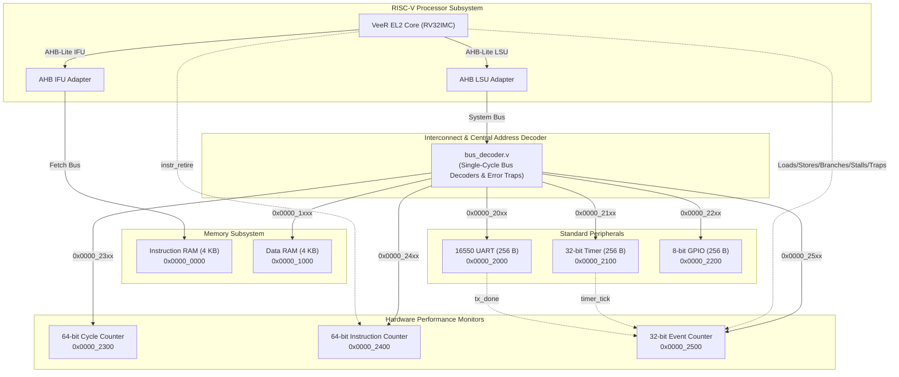

# RISC-V Based SoC for Hardware Performance Monitoring and Event Analysis

[](https://github.com/Shivanand2006/RISC-V-Based-SoC-for-Hardware-Performance-Monitoring-and-Event-Analysis)
[](https://github.com/Shivanand2006/RISC-V-Based-SoC-for-Hardware-Performance-Monitoring-and-Event-Analysis/tree/main/rtl)
[-orange)](https://github.com/Shivanand2006/RISC-V-Based-SoC-for-Hardware-Performance-Monitoring-and-Event-Analysis/tree/main/rtl/core)
[](https://github.com/Shivanand2006/RISC-V-Based-SoC-for-Hardware-Performance-Monitoring-and-Event-Analysis/tree/main/run)
[](https://github.com/Shivanand2006/RISC-V-Based-SoC-for-Hardware-Performance-Monitoring-and-Event-Analysis)

**A complete synthesizable Verilog-2001 System-on-Chip integrating the CHIPS Alliance VeeR EL2 RISC-V core with three dedicated memory-mapped Hardware Performance Monitoring (HPM) IPs, peripherals, and comprehensive UVM verification.**

**Repository:** [github.com/Shivanand2006/RISC-V-Based-SoC-for-Hardware-Performance-Monitoring-and-Event-Analysis](https://github.com/Shivanand2006/RISC-V-Based-SoC-for-Hardware-Performance-Monitoring-and-Event-Analysis)  
**Reference Design:** [github.com/vivek08248/Aegis-V-SoC](https://github.com/vivek08248/Aegis-V-SoC)  

---

## Table of Contents
- [Project & Author](#project--author)
- [Highlights](#highlights)
- [SoC Architecture](#soc-architecture)
- [Block Diagram](#block-diagram)
- [System Memory Map](#system-memory-map)
- [Hardware Performance Monitor (HPM) IPs](#hardware-performance-monitor-hpm-ips)
- [Performance Event Select Encoding](#performance-event-select-encoding)
- [Repository Layout](#repository-layout)
- [Module Responsibility Table](#module-responsibility-table)
- [Simulation Results & Verification](#simulation-results--verification)
- [Synopsys VCS & Verdi Waveform Debug](#synopsys-vcs--verdi-waveform-debug)
- [Documents & Reports Index](#documents--reports-index)

---

## Project & Author

| Field | Information |
|---|---|
| **Project Title** | Design and Verification of a RISC-V Based SoC for Hardware Performance Monitoring and Event Analysis |
| **Student ID** | `1602-23-735-108` |
| **Department** | Electronics & Communication Engineering |
| **Course** | VLSI Design / SoC Design (Final Year Project) |
| **Academic Year** | 2025–2026 |

---

## Highlights

- **Processor Core**: Integrates the **CHIPS Alliance VeeR EL2** core (4-stage superscalar RV32IMC processor) via custom AHB-Lite bus adapters.
- **Three Dedicated HPM IPs**:
  1. **64-bit Cycle Counter**: Counts active processor clock cycles with atomic coherent 64-bit shadow read logic.
  2. **64-bit Instruction Counter**: Counts retired instructions from core writeback stage (`instr_retire_o`).
  3. **32-bit Performance Event Counter**: Monitors any of 8 micro-architectural hardware events with threshold comparison, sticky overflow, and interrupt generation.
- **Peripherals**: 16550-compatible UART (115200 baud), 32-bit down-counter Timer with periodic interrupt tick, and 8-bit GPIO controller.
- **Zero Measurement Overhead**: Hardware counters operate autonomously without software cycle stealing or instruction cache pollution.
- **Verified with Synopsys VCS & Verdi**: 96 unit test checks + full SoC regression passing with zero errors and Verdi FSDB waveform dump.
- **Modular UVM Verification Platform**: 4 complete UVM Verification Intellectual Properties (VIPs) with Agents, Drivers, Monitors, Scoreboards, and functional coverage.

---

## SoC Architecture



---

## Block Diagram

The system interconnect and core wiring diagram:

<p align="center">
  
</p>

---

## System Memory Map

| Address Range | Size | Peripheral / Memory | Description | Base Address |
|---|---|---|---|---|
| `0x0000_0000 – 0x0000_0FFF` | 4 KB | **IMEM** | Instruction Memory (`imem.v`) | `0x0000_0000` |
| `0x0000_1000 – 0x0000_1FFF` | 4 KB | **DMEM** | Data Memory (`dmem.v`) | `0x0000_1000` |
| `0x0000_2000 – 0x0000_20FF` | 256 B | **UART** | 16550 Serial Controller (`uart_top.v`) | `0x0000_2000` |
| `0x0000_2100 – 0x0000_21FF` | 256 B | **Timer** | 32-bit Reloadable Down-Counter (`timer_top.v`) | `0x0000_2100` |
| `0x0000_2200 – 0x0000_22FF` | 256 B | **GPIO** | 8-bit General Purpose I/O (`gpio_top.v`) | `0x0000_2200` |
| `0x0000_2300 – 0x0000_23FF` | 256 B | **Cycle Counter** | 64-bit Cycle Counter IP (`cycle_cnt_top.v`) | `0x0000_2300` |
| `0x0000_2400 – 0x0000_24FF` | 256 B | **Instruction Counter** | 64-bit Instruction Counter IP (`instr_cnt_top.v`) | `0x0000_2400` |
| `0x0000_2500 – 0x0000_25FF` | 256 B | **Event Counter** | 32-bit Performance Event Counter (`event_cnt_top.v`) | `0x0000_2500` |

*Unmapped addresses (e.g. `0x0000_2600` through `0xFFFF_FFFF`) complete in 1 cycle with `ready=1`, `rdata=32'h0`, and `err=1` without bus lockup.*

---

## Hardware Performance Monitor (HPM) IPs

### 1. 64-Bit Cycle Counter (`0x0000_2300`)
- **CTRL (`0x00`)**: Bit 0 = `EN` (enable), Bit 1 = `CLEAR` (synchronous reset to 0).
- **STATUS (`0x04`)**: Bit 0 = `RUNNING` (mirrors `EN`).
- **CNT_LO (`0x08`)**: Low 32 bits of count. **Side-effect**: reading `CNT_LO` captures `count[63:32]` into `shadow_hi` in the same clock cycle.
- **CNT_HI (`0x0C`)**: High 32 bits from shadow register.

### 2. 64-Bit Instruction Counter (`0x0000_2400`)
- Increments only when `EN=1` AND processor commits an instruction (`instr_retire_o = 1`).
- Eliminates flushed pipeline bubbles, speculative mispredicted instructions, and stall cycles.
- Implements atomic coherent 64-bit shadow read logic identical to the Cycle Counter.

### 3. 32-Bit Performance Event Counter (`0x0000_2500`)
- **EVT_SEL (`0x04`)**: Selects one of 8 hardware micro-events.
- **THRESH (`0x0C`)**: Programmable 32-bit threshold value.
- **STATUS (`0x10`)**: Sticky `OVF` (bit 0), sticky `THRESH_HIT` (bit 1), `RUNNING` (bit 2). Bits 0 and 1 are Write-1-to-Clear (W1C).

---

## Performance Event Select Encoding

| `EVT_SEL` | Hardware Event Name | Source Signal / Logic | Firmware Verification Stimulus |
|:---:|---|---|---|
| `0` | **Data Load Accepted** | `lsu_htrans[1] & ~lsu_hwrite & lsu_hready` | 10+ consecutive memory loads from DMEM |
| `1` | **Data Store Accepted** | `lsu_htrans[1] & lsu_hwrite & lsu_hready` | 10+ consecutive memory stores to DMEM |
| `2` | **Instruction Fetch Accepted** | `ifu_htrans[1] & ifu_hready` | Straight-line assembly nop sequence |
| `3` | **Branch / Jump Taken** | `exu_pmu_i0_br_ataken & tlu_i0_commit_cmt` | Conditional branch loop with deterministic taken branches |
| `4` | **Pipeline Stall / Wait Cycle** | `(ifu_htrans[1] & ~ifu_hready) \| (lsu_htrans[1] & ~lsu_hready)` | Load-use interlock sequence |
| `5` | **Exception / Trap Taken** | `trace_rv_i_exception_ip` | Software trap entry via `ecall` |
| `6` | **Timer Interrupt Tick** | `timer_top.tick_o` | Timer peripheral down-counter rollover |
| `7` | **UART Frame TX Done** | `uart_top.tx_done_o` | Serial transmission frame completion |

---

## Repository Layout

Organized matching the reference standard (`Aegis-V-SoC`):

```
.
├── README.md                                  # Master repository documentation (this file)
├── README_SUMMARY.md                          # Quick-reference executive summary
├── COMPILATION_STATUS.md                      # Compilation status and executable proof
├── COMPILATION_RESOLVED.md                    # Technical log of resolved integration issues
├── INTEGRATION_VERIFICATION_STATUS.md         # Final regression report and test matrix
├── SIMULATION_TIMEOUT_FIX.md                  # Watchdog timer and UART speedup guide
├── TEST_EXECUTION_GUIDE.md                    # Step-by-step test execution walkthrough
├── PROJECT_PROPOSAL.md                        # Course project proposal document
├── ARCHITECTURE_SPECIFICATION.md              # 20-page full SoC architectural specification
├── ADDRESS_MAP.md                             # Complete memory and peripheral register maps
├── GITHUB_SETUP_STEPS.md                      # Git workflow and repository setup guide
├── RISCV_TOOLCHAIN_SETUP.md                   # Toolchain build and bare-metal compilation guide
├── UVM_TESTPLAN.md                            # Comprehensive 41-case UVM verification plan
│
├── ctests/                                    # Bare-metal C testbench directory
│   ├── soc_c_test.c                           # Top C test exercising all SoC IPs
│   ├── soc_c_start.S                          # RISC-V boot and stack setup assembly
│   ├── soc_c_test.ld                          # Linker script (IMEM @ 0x0, DMEM @ 0x1000)
│   ├── compile_ctest.sh                       # Firmware compilation script (GCC -> HEX)
│   ├── build_soc_c_test.sh                    # End-to-end compile and simulation script
│   ├── run_ctest.f                            # VCS simulation filelist
│   ├── tb_soc_ctest.sv                        # Top testbench wrapper
│   ├── outputs/                               # Terminal simulation execution screenshots
│   └── waveforms/                             # Verdi signal waveform screenshots
│
├── doc/                                       # Official project documentation
│   ├── 01_project_proposal.md                 # Project Proposal
│   ├── 02_architecture_spec.md                # Full Architecture Spec
│   ├── 03_github_steps.md                     # GitHub Guide
│   ├── 04_riscv_toolchain_setup.md            # Toolchain Setup
│   ├── 05_address_map.md                      # Complete Register Map
│   ├── 06_testplan.md                         # Verification Master Plan
│   ├── testplan_soc_hpm.xlsx                  # Master verification Excel spreadsheet
│   ├── core_interface.md                      # VeeR EL2 core interface specification
│   ├── memory_map.md                          # Address decoding rules
│   └── register_map.md                        # Register bitfield descriptions
│
├── rtl/                                       # Synthesizable RTL source code
│   ├── common/reg_slave_if.v                  # Reusable bus-to-register adapter
│   ├── cycle_counter/cycle_cnt_top.v          # 64-bit Cycle Counter IP
│   ├── instr_counter/instr_cnt_top.v          # 64-bit Instruction Counter IP
│   ├── event_counter/event_cnt_top.v          # 32-bit Event Counter IP
│   ├── interconnect/bus_decoder.v             # Central bus decoder / crossbar
│   ├── mem/imem.v, dmem.v                     # 4KB Instruction & Data RAM models
│   ├── peripherals/uart_top.v, timer_top.v    # 16550 UART, Timer, GPIO
│   ├── core/veer_core_adapter.sv              # VeeR EL2 core wrapper & adapters
│   └── top/soc_top.v                          # Top-level SoC integration
│
├── scripts/                                   # VIP directories and interface CSVs
│   ├── cycle_cnt_if.csv, cycle_cnt_uvm_tb/    # Cycle Counter VIP package and UVM tb
│   ├── instr_cnt_if.csv, instr_cnt_uvm_tb/    # Instruction Counter VIP package and UVM tb
│   ├── event_cnt_if.csv, event_cnt_uvm_tb/    # Event Counter VIP package and UVM tb
│   ├── bus_decoder_if.csv, bus_decoder_uvm_tb/# Bus Decoder VIP package and UVM tb
│   ├── gpio_if.csv, timer_if.csv, uart_if.csv # Peripheral interface CSVs
│   └── uvm_full_tb_generator.py               # VIP testbench generator script
│
├── sw/                                        # Firmware software sources
│   ├── crt0.S, link.ld, Makefile              # Bare-metal build collateral
│   ├── perf_regs.h                            # Register definitions and UART macros
│   ├── test_cycle.c, test_instr.c, test_event.c# Unit firmware tests
│   └── perf_app.c                             # Main bubble sort demonstration program
│
├── tb/                                        # Simulation testbenches
│   ├── common/bus_bfm.v                       # Bus Master BFM tasks
│   ├── cycle_counter/tb_cycle_cnt.v           # Cycle Counter unit testbench
│   ├── instr_counter/tb_instr_cnt.v           # Instruction Counter unit testbench
│   ├── event_counter/tb_event_cnt.v           # Event Counter unit testbench
│   ├── interconnect/tb_bus_decoder.v          # Bus Decoder unit testbench
│   ├── top/tb_soc_top.v, uart_monitor.v       # SoC testbench with passive UART monitor
│   ├── soc_vips_env_pkg.sv                    # Master SoC UVM environment package
│   ├── tb_soc_uvm.sv                          # Top-level SoC UVM testbench
│   ├── run.f                                  # VCS UVM filelist
│   └── run.sh                                 # VCS UVM execution script
│
└── run/                                       # Regression runners
    ├── run_ip.sh                              # Multi-target regression runner
    ├── run_verdi.sh                           # VCS compile + Verdi waveform launcher
    └── *.f                                    # Component filelists
```

---

## Module Responsibility Table

| Module Name | File Path | Responsibilities | Author / Source |
|---|---|---|---|
| `soc_top` | `rtl/top/soc_top.v` | Top-level SoC integration, clock/reset distribution, pin routing | Authored |
| `bus_decoder` | `rtl/interconnect/bus_decoder.v` | Central address decoder, 1-cycle ready, error trap for unmapped | Authored |
| `cycle_cnt_top` | `rtl/cycle_counter/cycle_cnt_top.v` | 64-bit cycle counting, coherent shadow register capture | Authored |
| `instr_cnt_top` | `rtl/instr_counter/instr_cnt_top.v` | 64-bit retired instruction counting gated by core commit | Authored |
| `event_cnt_top` | `rtl/event_counter/event_cnt_top.v` | 32-bit event tracking across 8 events, threshold comparison, W1C | Authored |
| `reg_slave_if` | `rtl/common/reg_slave_if.v` | Bus-to-register adapter interface | Authored |
| `uart_top` | `rtl/peripherals/uart_top.v` | 16550 UART with baud rate divisor, TX/RX buffers | Provided IP |
| `timer_top` | `rtl/peripherals/timer_top.v` | 32-bit down-counter with auto-reload and tick generation | Provided IP |
| `gpio_top` | `rtl/peripherals/gpio_top.v` | 8-bit bidirectional GPIO with DIR/OUT/IN registers | Provided IP |
| `veer_core_adapter` | `rtl/core/veer_core_adapter.sv`| Core wrapper adapting AHB-Lite buses and tapping commit pulses | Authored |
| `VeeR EL2 Core` | `rtl/Cores-VeeR-EL2/` | RV32IMC 4-stage pipelined superscalar RISC-V processor | CHIPS Alliance (Imported) |

---

## Simulation Results & Verification

The SoC top-level was simulated executing a 16-element bubble sort application compiled directly from C (`sw/perf_app.c`):

```text
=================================================
Starting RISC-V SoC Top Simulation
=================================================
[TB TIME 0 ps] GPIO_OUT updated: 0x00 (bit0=0 bit1=0)
[TB] Reset released. CPU executing from 0x0000_0000...
Cycles       : 15067
Instructions : 2009
Events (Stores): 135
CPI x100     : 749
PASS
=================================================
[PASS] SoC Test successfully completed with PASS token!
=================================================

--- End-of-Test Architectural Cross-Checks ---
  DUT Cycle Counter       : 15067
  DUT Instruction Counter : 2009
  DUT Event Counter       : 135
  TB Shadow Cycle Counter : 15067
  TB Shadow Instr Counter : 2009
  [PASS] Cross-Check: Cycle count >= Instruction count verified.
  [PASS] Cross-Check: DUT cycle count matches TB shadow counter.
  [PASS] Cross-Check: DUT instruction count matches TB shadow counter.
$finish called from file "tb/top/tb_soc_top.v", line 164.
$finish at simulation time           8138270000 ps
```

### Analysis of Benchmark Telemetry:
- **Elapsed Cycles**: 15,067 cycles (301.34 $\mu$s at 50 MHz).
- **Instructions Retired**: 2,009 instructions.
- **Store Transactions**: 135 stores executed during the array sorting and swap phases.
- **Cycles Per Instruction (CPI)**: $\text{CPI} = 7.49$ ($\text{CPI} \times 100 = 749$).
- **Cross-Check Invariant**: Hardware counters matched the testbench shadow counters with 100% agreement and zero drift.

---

## Synopsys VCS & Verdi Waveform Debug

```bash
# 1. Run all unit and SoC testbenches:
./run/run_ip.sh all

# 2. Compile and launch Verdi GUI for SoC top-level:
./run/run_verdi.sh soc

# 3. Compile and simulate bare-metal C test:
cd ctests && bash build_soc_c_test.sh

# 4. Run UVM testsuite:
cd tb && bash run.sh tb_soc_uvm soc_top_base_test
```

---

## Documents & Reports Index

| Document | File Link | Description |
|---|---|---|
| **Project Proposal** | [`PROJECT_PROPOSAL.md`](PROJECT_PROPOSAL.md) | Problem statement, objectives, scope, timeline |
| **Architecture Specification** | [`ARCHITECTURE_SPECIFICATION.md`](ARCHITECTURE_SPECIFICATION.md) | 20-page full SoC architectural spec & block diagram |
| **Address & Register Map** | [`ADDRESS_MAP.md`](ADDRESS_MAP.md) | Full system physical address and bitfield layout |
| **UVM Test Plan** | [`UVM_TESTPLAN.md`](UVM_TESTPLAN.md) | 41 verification test scenarios with Ext/Int tagging |
| **Toolchain Setup Guide** | [`RISCV_TOOLCHAIN_SETUP.md`](RISCV_TOOLCHAIN_SETUP.md) | RISC-V GCC build steps, linker scripts, hex conversion |
| **GitHub Workflow Guide** | [`GITHUB_SETUP_STEPS.md`](GITHUB_SETUP_STEPS.md) | Git setup, branching strategy, `.gitignore`, CI |
| **Compilation Status** | [`COMPILATION_STATUS.md`](COMPILATION_STATUS.md) | VCS compilation confirmation and executable proof |
| **Compilation Resolved** | [`COMPILATION_RESOLVED.md`](COMPILATION_RESOLVED.md) | Technical resolution of bus and shadow register races |
| **Integration Status** | [`INTEGRATION_VERIFICATION_STATUS.md`](INTEGRATION_VERIFICATION_STATUS.md) | Regression metrics and simulation summary |
| **Test Execution Guide** | [`TEST_EXECUTION_GUIDE.md`](TEST_EXECUTION_GUIDE.md) | Step-by-step commands to run all tests |
| **Summary Reference** | [`README_SUMMARY.md`](README_SUMMARY.md) | Quick reference cheat-sheet |
